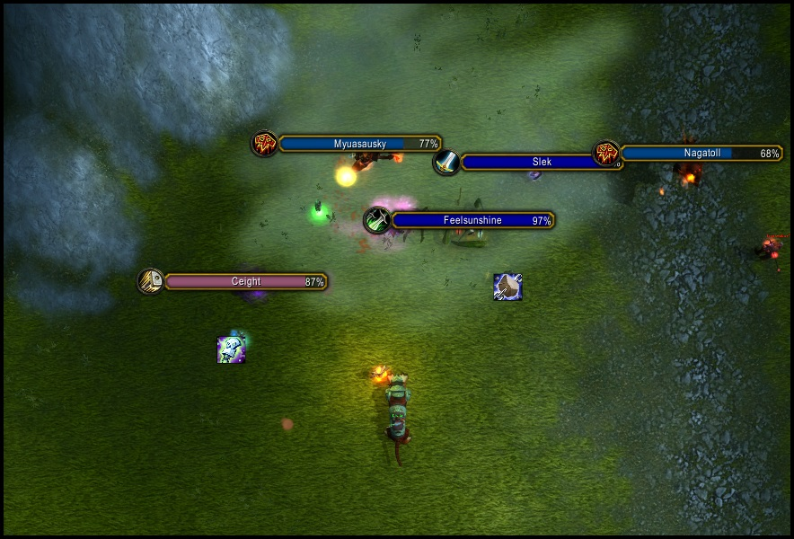
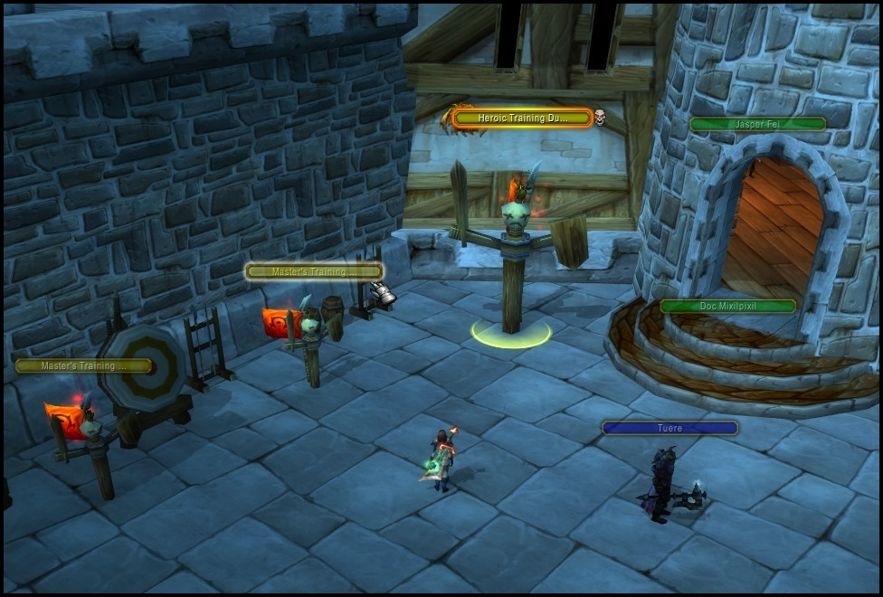
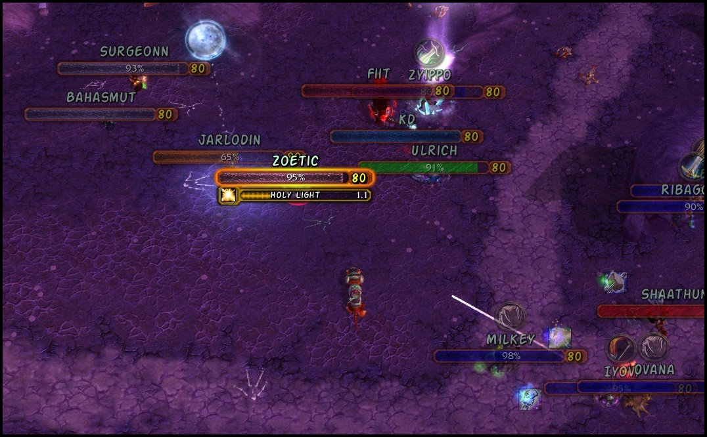
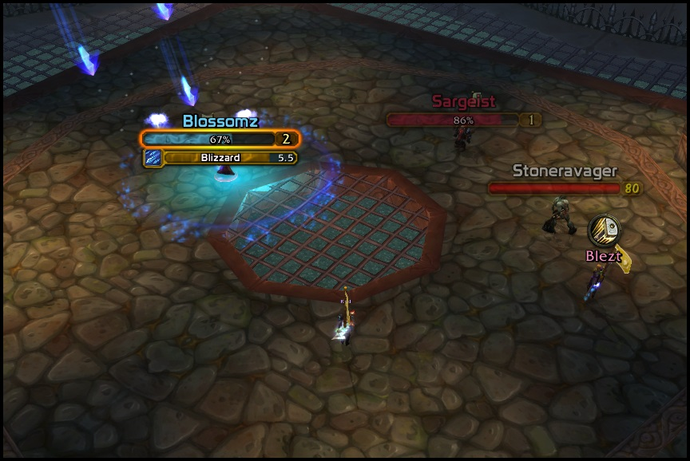
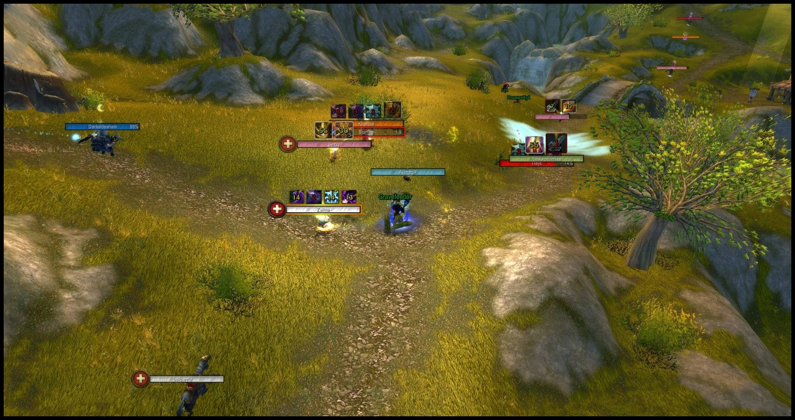
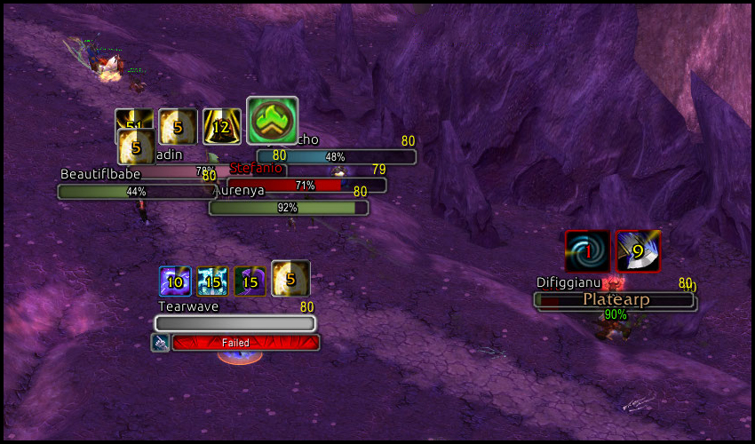
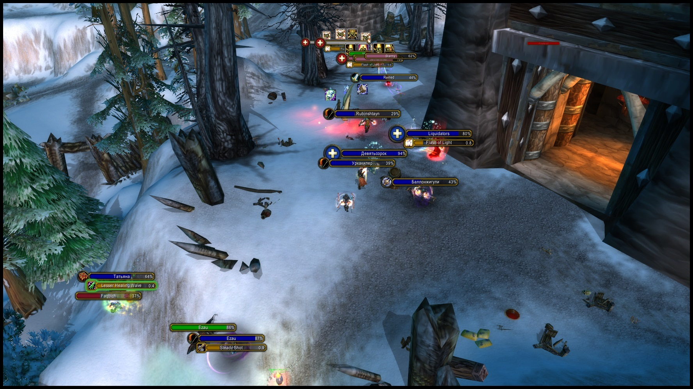
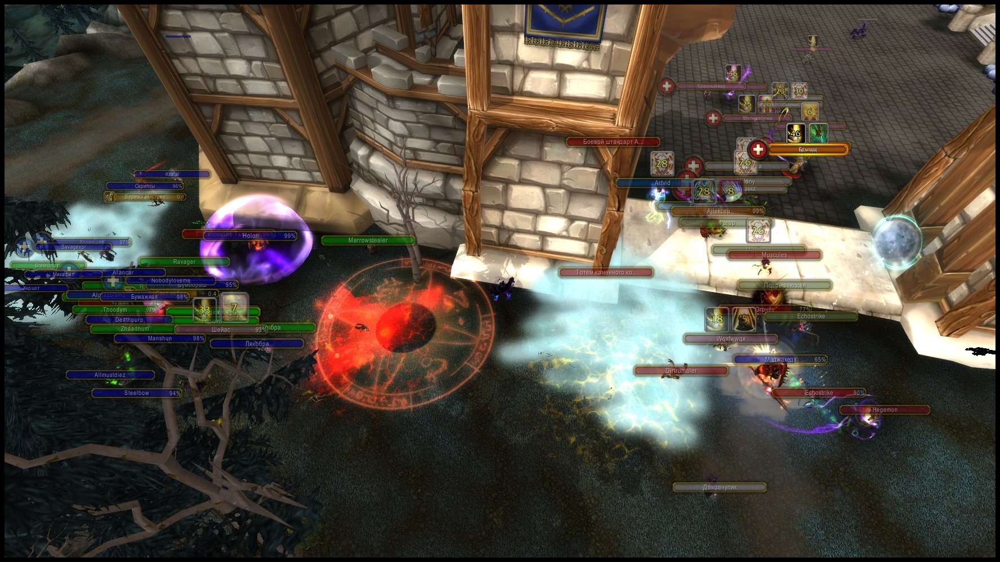

# RefinedBlizzPlates-WotLK
**RefinedBlizzPlates** is a lightweight nameplate addon for WoW 3.3.5a.  
Built around the default nameplates, enhancing them with visual refinements, useful features and alternative styles.

## Features  
- Four selectable nameplate styles: Classic, Refined, Clean and Modern.
- Multiple settings to customize the main visual regions for every style.
- Nameplate draw order based on distance from the camera.
- Adjusted frame level spacing to prevent regions of different nameplates from overlapping.
- Custom glow for target and mouseover nameplates.
- Optional class icons in PvE or PvP instances.
- Optional arenaID and partyID text in arenas.
- Optional combo points widget for Rogues and Druids.
- Integrated TotemPlates with settings for each totem type.
- Blacklist system for hiding specific nameplates or replacing them with icons.
- Optional "Barless Plates" mode that displays only names and indicators on friendly nameplates.
- Settings to adjust the clickbox of nameplates, totems and barless plates.
- Click-through behavior for blacklisted nameplates and, optionally, friendly nameplates.
- Optional system that simulates Retail's nameplate stacking.
- Depth Perception for distant nameplates by adjusting their scale and opacity.
- Improved compatibility with different versions of AwesomeWotlk.

## Recommendations
- Gladdy’s Totem Plates module may conflict with this addon. Disable the module to ensure proper functionality.
- The Retail-like stacking system was adapted from Cheeta's WeakAura. Delete or disable it to avoid conflicts.
- Users of Someweirdhuman's AwesomeWotlk must disable its hitbox CVars and use this addon's clickbox settings.

## Screenshots

Show screenshots

 

  

  

  

  

  

  

  

  

## Installation  
1. [Download](https://github.com/KhalGH/RefinedBlizzPlates-WotLK/releases/download/v1.13.2/RefinedBlizzPlates-v1.13.2.zip) the addon
2. Extract the **!!RefinedBlizzPlates** folder into `World of Warcraft/Interface/AddOns/`.
3. Restart the game and enable the addon.  

## Optional Dependencies  
The addon supports features from certain client modifications that are popular in the community, such as:
- Different versions of the AwesomeWotlk library. [[1]](https://github.com/FrostAtom/awesome_wotlk) [[2]](https://github.com/KhalGH/awesome_wotlk) [[3]](https://github.com/someweirdhuman/awesome_wotlk) [[4]](https://github.com/noname08662/awesome_wotlk)
- A [patch](https://raw.githubusercontent.com/KhalGH/RefinedBlizzPlates-WotLK/assets/assets/Non-target_CastBars.zip) that enables cast bars on non-target nameplates.
- A [patch](https://raw.githubusercontent.com/KhalGH/RefinedBlizzPlates-WotLK/assets/assets/Extended_Nameplate_Distance.zip) that extends nameplate viewing distance.

**Disclaimer**: Some servers may have specific rules regarding the use of client modifications. Please check your server's policy to ensure they are allowed before using them.

## Information  
- **Addon Version:** 1.13.2  
- **Game Version:** 3.3.5a (WotLK)  
- **Author:** Khal  
